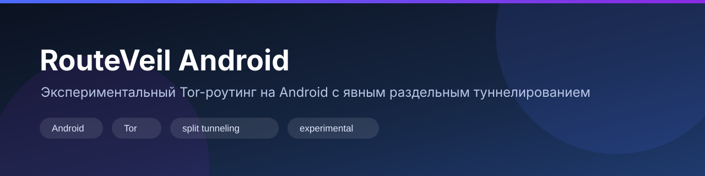

**← [Все проекты · All projects](https://github.com/rukazax?tab=repositories)**

  

# routeveil-android

**RU** · [English](#english)

> Экспериментальный Android-клиент: Tor-маршрутизация трафика, явный split tunneling и диагностика с сохранением приватности.

## 🧪 Что это

**routeveil-android** — экспериментальный Android-клиент (Experimental Android Tor routing, explicit split tunneling and privacy-preserving diagnostics). Три опоры проекта:

- **Tor-маршрутизация** — трафик уходит через сеть Tor.
- **Явный split tunneling** — что идёт через Tor, задаётся явно, а не по умолчанию.
- **Диагностика с сохранением приватности** — диагностика построена так, чтобы не раскрывать приватные данные.

## ⚠️ Статус

Проект **экспериментальный**: интерфейсы, поведение и сборка могут меняться. Стабильность не гарантируется — использование на свой страх и риск.

## English

> An experimental Android client: Tor traffic routing, explicit split tunneling and privacy-preserving diagnostics.

### What it is

**routeveil-android** is an experimental Android client built on three pillars:

- **Tor routing** — traffic goes through the Tor network.
- **Explicit split tunneling** — what goes through Tor is decided explicitly, not by default.
- **Privacy-preserving diagnostics** — diagnostics are designed not to expose private data.

### Status

The project is **experimental**: interfaces, behavior and builds may change. No stability guarantees — use at your own risk.

---

#android #tor #split-tunneling #privacy #diagnostics #routing #experimental #mobile
